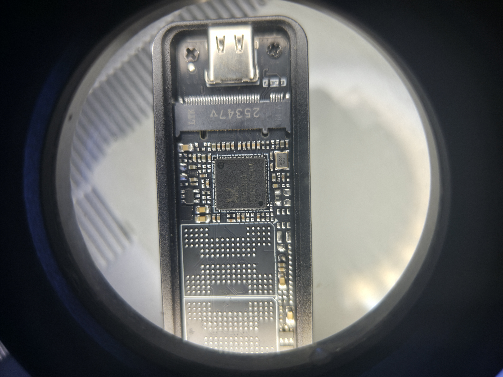
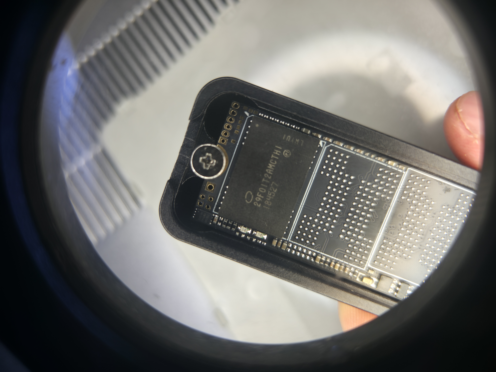
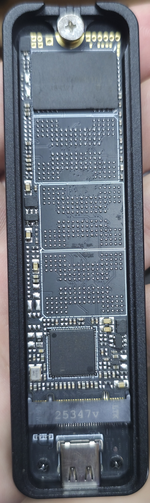
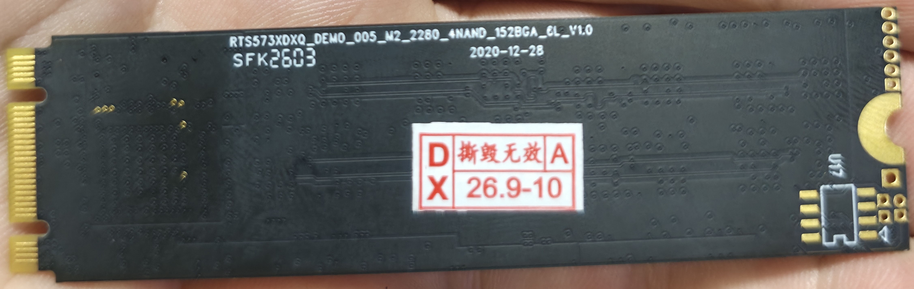

# Из поддельных 2 ТБ в рабочие 120 ГБ: восстановление SSD Realtek RTS5733DLQ

**M.2 SATA SSD · Realtek RTS5733DLQ · Intel B17A NAND 29F01T2AMCTH1 · SSDMP 2.74.0.0.**

После восстановления диск показывает **120 034 123 776 байт**, примерно **111,8 ГиБ**. Весь объём записан, затем прочитан и побайтово сверен без ошибок. Испытание закончено 28 октября 2026 года за 47 минут 44 секунды.

**English:** Recovery of a fake 2 TB M.2 SATA SSD to a verified 120 GB capacity. [English summary](docs/ENGLISH.md).

> Прошивка удаляет данные. Этот профиль рассчитан на Intel B17A с указанными ниже NAND ID и расположением CH/CE. Загрузочный диск выбирать нельзя.

## Содержание

- [Оборудование и фотографии](#оборудование-и-фотографии)
- [Что понадобится](#что-понадобится)
- [Пошаговая инструкция](#пошаговая-инструкция)
- [Ошибки и результат](#ошибки-и-результат)
- [Точные параметры и выход из LLF](docs/TECHNICAL.md)
- [Хронология эксперимента](docs/TIMELINE.md)

## Оборудование и фотографии

| Узел | Наш экземпляр |
|---|---|
| Формат | M.2 2280 **SATA**, ключи B+M; не NVMe |
| Контроллер | **RTS5733DLQ**, в SSDMP — RTS5733DL |
| Маркировка NAND | **29F01T2AMCTH1**, следующая строка `184527` |
| Семейство | Intel B17A, 3D TLC |
| Имя в базе SSDMP | `PF29R01T2AMCTH1 (B17A)` — R взята из базы, не с фотографии |
| NAND ID | `89 C4 08 32 A6 00 00 00` |
| Активные позиции | **CH0/CE4 и CH1/CE4** |
| Плата | `RTS573XDXQ_DEMO_005_M2_2280_4NAND_152BGA_2L_V1.0`, дата `2020-12-28` |
| Исходная модель | SSD 2TB |
| Сервисное определение | REALTEK_RL6531, FW 3.AAE, **1 179 136 байт** |
| Рабочее определение | Realtek SATA Drive, **120 034 123 776 байт** |

На фотографиях — наш SSD. Два общих снимка обрезаны по плате и боксу; маркировки не изменены. Нажмите на фото, чтобы открыть полный размер.

**Контроллер:**

<a href="images/controller.jpg"></a>

**Память Intel:**

<a href="images/nand.jpg"></a>

**Лицевая сторона в USB-боксе:**

<a href="images/board-front.jpg"></a>

**Обратная сторона платы:**

<a href="images/board-back.jpg"></a>

## Что понадобится

1. Компьютер со **слотом M.2, поддерживающим SATA**. Мы использовали ноутбук, в котором SSD уже работал. Слот NVMe без поддержки SATA не подойдёт.
2. Windows на другом накопителе. В нашем случае она была загружена с отдельного USB SSD. Его разделы и данные не изменяли.
3. **[Скачать SSDMP с прошивкой и профилем на 120 ГБ](https://github.com/maks421400-lgtm/realtek-rts5733-ssd-recovery/raw/refs/heads/main/tools/SSDMP-RTS5733DLQ-Intel-B17A-120GB.zip)**. В ZIP уже выбран профиль `intel120_id.ini`, автоматический Start выключен.
4. [H2testw](https://www.heise.de/download/product/h2testw-50539) для проверки записью и чтением после прошивки.

В комплекте — SSDMP 2.74.0.0_20230414_D_X64, DLL, прошивка `B17A_GLU_DL-RS10S1C9_VA001CC9` и скрипты. [Состав и контрольная сумма ZIP](tools/README.md). EXE и прошивка взяты из архива владельца без изменений; это не официальный выпуск Realtek.

| Файл | SHA-256 |
|---|---|
| Исходный RAR | `04807BC350606AD69E022E058469FBF6D02E0CF1C2178A79E138165BDE326078` |
| `X64_Debug/SSDMP.exe` | `59533152D17EAA93B11798127DEBBF584388D6382D8FB20E91F970DF4C411F74` |

## Пошаговая инструкция

### 1. Найдите именно целевой диск

Сверьте маркировки со снимками. В PowerShell от администратора выполните:

```powershell
Get-Disk | Format-Table Number,FriendlyName,SerialNumber,BusType,Size,IsBoot,IsSystem
```

Запишите модель, серийный номер и интерфейс. Номер диска может измениться после переподключения, поэтому выбирать только по номеру нельзя. Целевой SSD не должен иметь `IsBoot=True` или `IsSystem=True`. Серийный номер в сервисном режиме и после прошивки может отличаться от исходного.

Если нужны данные с этого SSD, остановитесь: описанный способ предназначен для восстановления работоспособности с уничтожением данных.

### 2. Подключите SSD напрямую

Выключите ноутбук, отключите зарядку и аккумулятор согласно руководству производителя, установите SSD в SATA-совместимый M.2. **Не извлекайте и не устанавливайте M.2 при подключённом питании.** Загрузите Windows с другого диска.

Через наш USB-бокс Read ID работал, но полный цикл восстановления не завершался. Переход на кабель USB 2.0 не решил проблему. На прямом SATA тот же комплект SSDMP прошёл LLF. Причину несовместимости этого бокса отдельно установить не удалось.

### 3. Прочитайте NAND ID, не нажимая Start

Распакуйте скачанный ZIP в отдельную папку. Запустите `X64_Debug\SSDMP.exe` от администратора, сверьте целевой SSD. Нажмите **Read ID**, дождитесь окончания, откройте **Flash Id**. Наш ответ:

```text
CH0 CE4: 89 C4 08 32 A6 00 00 00
CH1 CE4: 89 C4 08 32 A6 00 00 00
```

Остальные видимые позиции были нулевыми. Если ID или активные CH/CE отличаются, **не применяйте этот профиль**. Одного совпадения ID тоже недостаточно без сверки корпуса NAND.

`Pass` после Read ID означает только успешное чтение ID — не прошивку и не исправность всех ячеек.

### 4. Подготовьте INI при закрытой SSDMP

**Если скачали ZIP из этой статьи, профиль уже готов. Переходите к шагу 5.** Следующие команды нужны только для исходного RAR без профиля Intel.

Полностью закройте программу и сделайте отдельную копию распакованного пакета. Сохраните [Prepare-Profile.ps1](scripts/Prepare-Profile.ps1) и запустите:

```powershell
powershell.exe -NoProfile -ExecutionPolicy Bypass -File .\Prepare-Profile.ps1 -PackageRoot "C:\SSD-Recovery\mp"
```

Укажите свою папку, внутри которой лежат `X64_Debug` и папка прошивки. `Bypass` действует только на этот запуск PowerShell.

Скрипт проверяет хеш EXE, создаёт **`intel120_id.ini`**, сохраняет резервную копию `Setting.dat` и выбирает новый профиль. Он **не обращается к накопителям и не запускает прошивку**. Автоматический Start выключен. Повторный запуск на уже подготовленной папке остановится.

Отдельное имя важно: в этой версии обработка ожидаемого ID в пользовательском профиле отличалась от штатного `config_6531.ini`. В новый профиль добавлен `PAR_1=ID: 89 C4 08 32 A6 00 00 00`; проверки `CHECK_FLASH_ID=1` и `CHECK_FLASH_ID_LEN=6` сохранены. [Все изменения и основания](docs/TECHNICAL.md).

### 5. Сверьте настройки до Start

Запустите SSDMP из подготовленной копии. Вверху должен быть выбран `intel120_id.ini`.

| Поле | Значение |
|---|---|
| Device | RTS5733DL |
| Flash Info | intel / PF29R01T2AMCTH1 (B17A) |
| CH / CE / Plane | 2 / 1 / 4 |
| Capacity | 120 |
| LLF Mode | Force Inherit DBT |
| MP Station | MP |
| DL Mode | включён |
| FW Update Only / Clear Mode | выключены |

Серые поля не мешали загрузке значений из INI. CE=1 здесь означает число CE **на канал**. Это не Package Count.

Не нажимайте замок ради редактирования Flash Info. Если появился пароль, это блокировка настроек программы, а не установленный нами пароль SSD. Для описанного пути пароль не нужен: INI готовится при закрытой программе. Подтверждённого универсального пароля в материалах нет.

Профиль включает только DUT0, но **это не гарантирует выбор нужного SSD**: ещё раз сверьте устройство в интерфейсе. При несовпадении остановитесь.

### 6. Выполните один цикл MP

Нажмите зелёный **Start** один раз. Не отключайте питание во время операции. В нашем случае прошли `Check flash id`, `Switch To Llf Mode`, загрузка SPI, `Check Flash Type`, `Llf Init`, `Do LLF`:

```text
Pass (120G)        Test time: 65 s
Model name: Realtek SATA Drive
Capacity: 120GB
```

65 секунд — время нашего экземпляра, не универсальный тайм-аут. При Fail не повторяйте Start без анализа. После завершения закройте SSDMP: журналы находятся рядом с EXE и в подпапке `LlfMsg`.

### 7. Проверьте выход из сервисного режима

После Pass Windows всё ещё показывала `REALTEK_RL6531` и 1,18 МБ. Обновление сведений, перезапуск устройства и обычное выключение ноутбука со встроенным аккумулятором не помогли.

**Рабочая ёмкость появилась после физического переподключения M.2.** Повторять это можно только на полностью обесточенном ноутбуке, с отключённой батареей, согласно руководству производителя.

Перед переподключением мы отправили **`SetFWMode(0)`**. Команда была принята без ATA-ошибки, но немедленно состояние не изменилось. Без этой команды повторный опыт не проводили, поэтому пока неизвестно, достаточно ли одного снятия питания. [Точная команда и ограниченный скрипт для совпадающего сервисного состояния](docs/TECHNICAL.md#выход-из-сервисного-режима).

Повторите `Get-Disk`. Ожидаемый результат нашего случая: **Realtek SATA Drive, 120 034 123 776 байт**. Если остаётся 1,18 МБ, рабочая прошивка ещё не запустилась; форматирование этого маленького устройства ситуацию не исправит.

### 8. Проверьте весь объём

Недостаточно увидеть 120 GB или скопировать один файл. Сначала заполняют весь объём различающимися данными, затем читают всё обратно. Это позволяет обнаружить ложную адресацию, при которой запись в конец портит начало диска.

Наш тест работал напрямую по физическому устройству; он описан в [техническом приложении](docs/TECHNICAL.md#полная-проверка-объёма). Исходный тест с жёстко заданным номером нашего диска не предлагается запускать на других компьютерах.

Более доступная альтернатива — создать раздел на целевом SSD, быстро отформатировать его и запустить **H2testw → all available space → Write + Verify**. [Страница издателя Heise](https://www.heise.de/download/product/h2testw-50539). H2testw проверяет свободное место раздела; наш тест проверял физическое устройство целиком.

В «Управлении дисками» выбирайте накопитель по сверенной модели и ёмкости, не по номеру из статьи. Наше испытание завершилось **до создания файлового раздела**: владелец решил выполнить этот шаг самостоятельно.

## Ошибки и результат

| Симптом | Что проверять |
|---|---|
| Flash Info неактивен | Имя и содержимое загруженного INI |
| Micron / 240 ГБ вместо Intel | Исходный профиль не соответствует нашей памяти |
| Read ID проходит, Check flash id падает | Пользовательское имя INI, PAR_1, карта банков; проверки не отключать |
| CH1 CE0, CH0 CE6, CH1 CE2 FAIL | Штатная карта ожидала другие активные банки |
| USB читает ID, но LLF не проходит | Прямое SATA-подключение; Read ID не проверяет весь служебный обмен |
| После Pass — 1,18 МБ | Запуск рабочей прошивки и полное снятие питания, см. шаг 7 |
| Ошибки полного теста | Работоспособность и ёмкость не подтверждены |

Итог проверки: **`PASS verified_bytes=120034123776 elapsed_s=2863,7`**.

[Полный обезличенный журнал](evidence/verification.txt) · [Этапы MP](evidence/mp-result.txt) · [Выдержки NAND](evidence/nand-excerpts.txt)

Все 120 ГБ прошли запись и чтение без ошибок. Остаточный ресурс памяти неизвестен.

## Поиск и обратная связь

Ключевые запросы: **восстановление SSD RTS5733DLQ**, **REALTEK_RL6531 1MB**, **SSDMP Check flash id Fail**, **Intel B17A 29F01T2AMCTH1**, **поддельный SSD 2 ТБ 120 ГБ**, **fake SSD capacity repair**, **M.2 SATA SSD recovery**, **PF29R01T2AMCTH1**, **89 C4 08 32 A6**, **LLF mode**.

Теги: `#ssd` `#ssd-recovery` `#realtek` `#rts5733dlq` `#intel-b17a` `#fake-ssd` `#m2-sata` `#ssdmp` `#nand-flash`.

В Issue укажите контроллер, маркировку памяти, ID по каналам, версию пакета и этап ошибки. Удалите из журналов личные пути, пароли, сетевые адреса и сведения о посторонних дисках.
